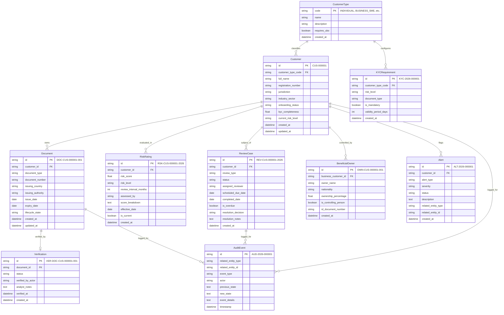

# Database Schema Documentation: KYC Compliance Platform

## 1. Entity-Relationship Overview

The platform implements 10 core entities with strict relational integrity, foreign key constraints, and cascade policies.

---

## 2. Cardinality and Relationship Details

| Relationship | Cardinality | Parent Entity | Child Entity | Foreign Key | Cascade Rule | Business Meaning |
|---|---|---|---|---|---|---|
| Customer Classification | 1 : N | `CustomerType` | `Customer` | `customer_type_code` | RESTRICT | A customer must belong to an existing customer type. |
| Compliance Rules | 1 : N | `CustomerType` | `KYCRequirement` | `customer_type_code` | CASCADE | Customer types dictate mandatory/optional requirements. |
| Customer Evidence | 1 : N | `Customer` | `Document` | `customer_id` | CASCADE | A customer may upload multiple documents across their lifecycle. |
| Document Verification | 1 : 1 (or 1 : N audit) | `Document` | `Verification` | `document_id` | CASCADE | Each document undergoes operational verification checks. |
| Risk Rating History | 1 : N | `Customer` | `RiskRating` | `customer_id` | CASCADE | Multiple historical ratings; one active `is_current = TRUE`. |
| Review Governance | 1 : N | `Customer` | `ReviewCase` | `customer_id` | CASCADE | Periodic and event-triggered review instances. |
| Beneficial Ownership | 1 : N | `Customer` | `BeneficialOwner` | `business_customer_id` | CASCADE | Corporate customers link to natural person owners. |
| Operational Alerts | 1 : N | `Customer` | `Alert` | `customer_id` | CASCADE | System flags non-compliance, expiry, and discrepancies. |
| Audit Trail | 1 : N (Polymorphic) | Any Entity | `AuditEvent` | `related_entity_id` | SET NULL / RETAIN | Complete immutable historical ledger. |

---

## 3. Referential Integrity and Constraints

1. **Deterministic Primary Keys**: Enforced via `PRIMARY KEY` constraint on all tables.
2. **Foreign Key Integrity**: All foreign keys reference valid parent records; index created on all FK columns for fast join performance.
3. **Check Constraints**:
   - `kyc_completeness BETWEEN 0.0 AND 100.0`
   - `risk_score BETWEEN 0.0 AND 100.0`
   - `ownership_percentage > 0.0`
4. **Historical Immutability**:
   - `AuditEvent` records are write-only (never updated or deleted).
   - Old `RiskRating` records retain `is_current = FALSE` upon risk reassessment.
